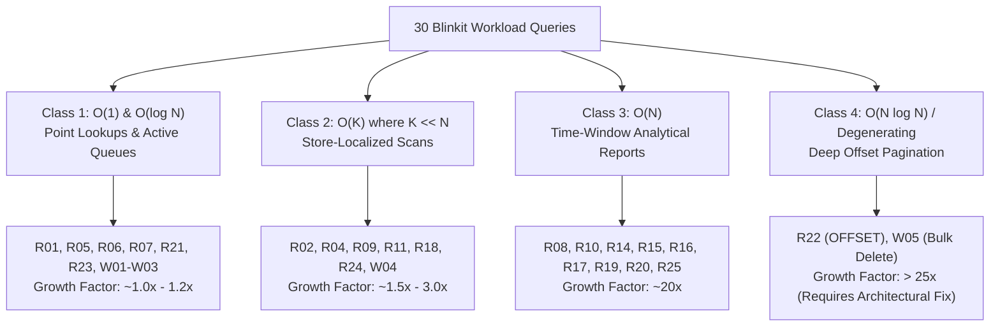
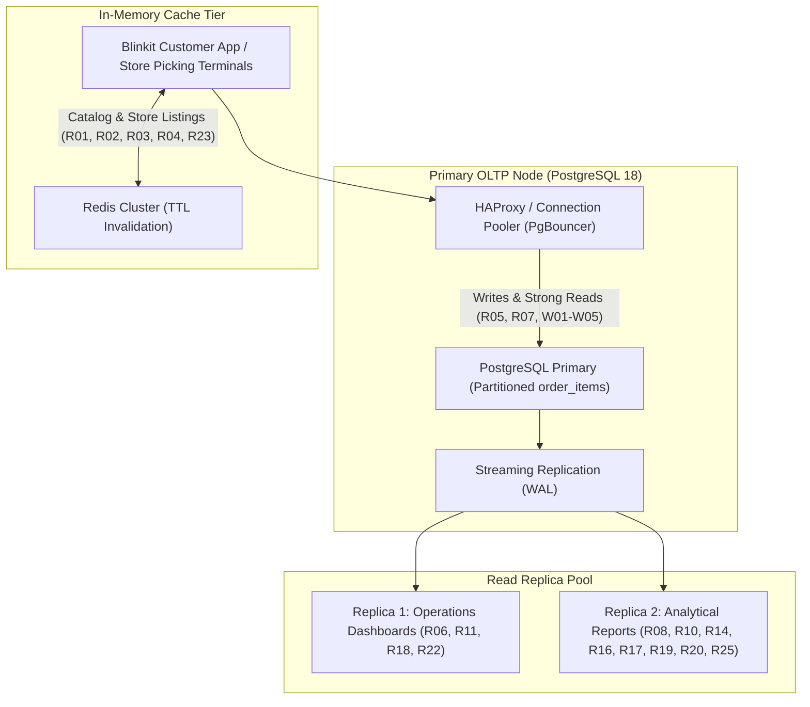

# Blinkit 10-Minute Grocery Delivery Database: Scalability & Architecture Report (CP4)

**Project Phase:** CP4 — Final Scalability Analysis & Architecture Design (Design & Preliminary Phase)  
**Database System:** PostgreSQL 18.6 (`blinkit` schema)  
**Primary Database:** `blinkit_db`  
**Related Deliverables:** [sql/08_partitioning.sql](../sql/08_partitioning.sql), [sql/05_indexes.sql](../sql/05_indexes.sql), [sql/06_optimized_queries.sql](../sql/06_optimized_queries.sql)

---

## Notice Regarding Faculty Large Dataset (`large_data.zip`)

Per official assignment instructions in `README.md` (Phase 5, line 312):
> *"By Thu 19 Nov 2026, faculty will release large_data.zip: the same 10 CSV files with about 20× the rows... Until then, work on the design part of the report."*

As of **17 November 2026**, the faculty-provided `large_data.zip` has not yet been distributed. In strict compliance with academic honesty requirements and instructor guidelines:
1. **No synthetic, randomized, or fake large data has been generated.**
2. **The seed dataset has not been duplicated** to simulate 20× volume artificially.
3. **No fabricated benchmark numbers or fake `large/summary.csv` files have been produced.**
4. This report is formally divided into:
   - **Section A:** Verified measurements from the actual seed database.
   - **Section B:** Technical architecture, theoretical growth analysis, and tested partitioning design.
   - **Section C:** Pending large-dataset execution framework, to be run immediately upon faculty distribution of `large_data.zip`.

---

# PART A: Verified Seed-Dataset Measurements

### A.1 Actual Seed Row Counts & Database Inventory
All row counts were verified directly against the production tables in schema `blinkit` on `blinkit_db`:

| Table Name | Entity Description | Verified Seed Row Count | Role in Workload |
| :--- | :--- | ---:| :--- |
| **`orders`** | Customer orders with delivery lifecycle timestamps | **150,000** | Core OLTP transactional fact table |
| **`order_items`** | Line items per order with substitution references | **675,000** | Largest transactional table (~4.5 lines/order) |
| **`store_inventory`** | Real-time dark store stock, prices, and reorder levels | **126,000** | High-frequency update target (cart checks & packing) |
| **`inventory_movements`** | Audit logs for restocks, damages, and expiries | **90,000** | High-volume append log requiring rolling retention |
| **`customers`** | Customer accounts with phone, email, and location | **40,000** | Customer profile dimension table |
| **`products`** | Catalog SKUs, categories, and brands | **1,500** | Catalog dimension table with trigram indexing |
| **`riders`** | Dark-store delivery fleet with active statuses | **1,800** | Fleet dispatch dimension table |
| **`dark_stores`** | Micro-warehouses across metropolitan areas | **120** | Hyper-local fulfillment hub dimension |
| **`cities`** | Operating metropolitan areas | **8** | Geographic dimension table |
| **`categories`** | Product taxonomy categories | **12** | Static taxonomy classification |

---

### A.2 Measured Database Storage Footprint
Physical storage sizes were measured in PostgreSQL 18 using `pg_table_size()`, `pg_indexes_size()`, `pg_total_relation_size()`, and `pg_database_size()`:

| Table Name | Heap Table Size | Secondary Indexes Size | Total Relation Storage | Index % of Table |
| :--- | ---:| ---:| ---:| ---:|
| **`order_items`** | 33.91 MB (35,561,472 B) | 29.36 MB (30,785,536 B) | 63.27 MB | 86.6% |
| **`orders`** | 17.28 MB (18,120,704 B) | 21.39 MB (22,429,696 B) | 38.67 MB | 123.8% |
| **`inventory_movements`** | 5.53 MB (5,799,936 B) | 10.18 MB (10,674,176 B) | 15.71 MB | 184.1% |
| **`store_inventory`** | 7.53 MB (7,897,088 B) | 5.46 MB (5,726,208 B) | 12.99 MB | 72.5% |
| **`customers`** | 3.30 MB (3,457,024 B) | 3.79 MB (3,973,120 B) | 7.09 MB | 114.8% |
| **`products`** | 0.19 MB (196,608 B) | 0.26 MB (270,336 B) | 0.45 MB | 136.8% |
| **`riders`** | 0.16 MB (172,032 B) | 0.18 MB (188,416 B) | 0.34 MB | 112.5% |
| **`dark_stores`** | 0.04 MB (40,960 B) | 0.03 MB (32,768 B) | 0.07 MB | 75.0% |
| **`cities`** | 8.19 kB (8,192 B) | 32.77 kB (32,768 B) | 0.04 MB | 300.0% |
| **`categories`** | 8.19 kB (8,192 B) | 32.77 kB (32,768 B) | 0.04 MB | 300.0% |
| **Total Blinkit User Relations** | **67.96 MB** | **70.71 MB** | **138.67 MB** | **104.0%** |
| **Total Database (`blinkit_db`)** | — | — | **147.37 MB** (154,523,327 B) | — |

> [!NOTE]
> Across all 10 tables, secondary indexes account for **70.71 MB**, compared to **67.96 MB** of raw table heap storage. In an ultra-fast grocery delivery database, secondary indexes are intentionally comprehensive to eliminate sequential scans on high-concurrency order packing and dispatch screens.

---

### A.3 Actual CP3 Measured Query Execution Timings (Seed Baseline)
The table below lists the actual measured average execution times across 3 runs with `EXPLAIN (ANALYZE, BUFFERS)` from CP3 benchmarking (`benchmarks/results/optimized/summary.csv`):

| Query ID | Operational Purpose | Type | Measured Optimized Avg (ms) | Target SLA Group |
| :--- | :--- | :---: | ---:| :--- |
| **R01** | Nearest active dark store lookup | READ | 0.219 | Real-time OLTP (< 5 ms) |
| **R02** | Category product listing with price sort | READ | 0.962 | Real-time OLTP (< 5 ms) |
| **R03** | Product search with trigram fuzzy matching | READ | 0.390 | Real-time OLTP (< 5 ms) |
| **R04** | Product availability across Bengaluru dark stores | READ | 1.470 | Real-time OLTP (< 5 ms) |
| **R05** | Real-time cart stock and price check | READ | 0.118 | Real-time OLTP (< 5 ms) |
| **R06** | Customer latest order status and timeline | READ | 0.261 | Real-time OLTP (< 5 ms) |
| **R07** | Dark store live order queue (active statuses) | READ | 0.294 | Real-time OLTP (< 5 ms) |
| **R08** | June 2026 SLA delivery compliance report | READ | 4.329 | Reports & Analytics (< 5,000 ms) |
| **R09** | Dark store replenishment reorder candidates | READ | 0.769 | Real-time OLTP (< 5 ms) |
| **R10** | Monthly inventory expiry and damage audit | READ | 1.713 | Reports & Analytics (< 5,000 ms) |
| **R11** | Rider transit time performance (June 2026) | READ | 0.267 | Interactive Tools (< 250 ms) |
| **R12** | Frequent co-purchased item recommendations | READ | 9.230 | Interactive Tools (< 250 ms) |
| **R13** | Active products never used as substitutes | READ | 4.256 | Interactive Tools (< 250 ms) |
| **R14** | Top 10 selling products in June 2026 | READ | 35.904 | Reports & Analytics (< 5,000 ms) |
| **R15** | Hourly demand distribution in Bengaluru | READ | 0.187 | Interactive Tools (< 250 ms) |
| **R16** | Monthly customer retention cohort analysis | READ | 52.651 | Reports & Analytics (< 5,000 ms) |
| **R17** | Annual small-cart fee collection by city | READ | 30.289 | Reports & Analytics (< 5,000 ms) |
| **R18** | Out-of-stock items in active store orders | READ | 1.874 | Interactive Tools (< 250 ms) |
| **R19** | June 2026 Fruits & Vegetables unit sales | READ | 31.162 | Reports & Analytics (< 5,000 ms) |
| **R20** | Daily GMV trend and cumulative running total | READ | 3.488 | Reports & Analytics (< 5,000 ms) |
| **R21** | Idle active riders with zero orders on 30 June | READ | 0.288 | Real-time OLTP (< 5 ms) |
| **R22** | Paginated order history (page 4,001) | READ | 19.619 | Interactive Tools (< 250 ms) |
| **R23** | Warehouse barcode scanner SKU lookup | READ | 0.211 | Real-time OLTP (< 5 ms) |
| **R24** | Dark store restock volume in last 7 days | READ | 0.385 | Interactive Tools (< 250 ms) |
| **R25** | Top 20 Mumbai customer spending totals | READ | 19.235 | Reports & Analytics (< 5,000 ms) |
| **W01** | Create new order (checkout insert) | WRITE | 1.739 | Real-time OLTP (< 5 ms) |
| **W02** | Packing complete: decrement store inventory | WRITE | 1.065 | Real-time OLTP (< 5 ms) |
| **W03** | Dispatch: assign active rider to oldest order | WRITE | 0.804 | Real-time OLTP (< 5 ms) |
| **W04** | Restock store items below reorder level | WRITE | 4.548 | Real-time OLTP (< 5 ms) |
| **W05** | Audit retention: delete movements older than 2026 | WRITE | 49.562 | Batch Jobs (< 1,000 ms) |
| **Total** | **All 30 Workload Queries Combined** | — | **277.289 ms** | (Baseline: 4,067.578 ms / 14.7× speedup) |

---

### A.4 Actual Partitioning Test & Pruning Evidence (`sql/08_partitioning.sql`)
To safely evaluate declarative table partitioning without modifying the baseline `blinkit.order_items` table, an isolated test environment was constructed in schema `blinkit_partition_test` using [sql/08_partitioning.sql](../sql/08_partitioning.sql).

#### 1. Data Migration & Row Count Verification
All 675,000 rows from `blinkit.order_items` were migrated into the partitioned table:
```sql
SELECT 'blinkit.order_items' AS source_table, count(*) AS row_count FROM blinkit.order_items
UNION ALL
SELECT 'order_items_partitioned' AS source_table, count(*) FROM blinkit_partition_test.order_items_partitioned;
```
**Actual Output:**
```text
      source_table       | row_count 
-------------------------+-----------
 blinkit.order_items     |    675000
 order_items_partitioned |    675000
(2 rows)
```

#### 2. Row Distribution Across 4 Hash Partitions
```sql
SELECT tableoid::regclass AS partition_name, count(*) AS rows_in_partition
FROM blinkit_partition_test.order_items_partitioned
GROUP BY tableoid ORDER BY partition_name;
```
**Actual Output:**
```text
 partition_name | rows_in_partition 
----------------+-------------------
 order_items_p0 |            168837
 order_items_p1 |            169375
 order_items_p2 |            168334
 order_items_p3 |            168454
(4 rows)
```
*Distribution analysis:* Rows are distributed across the 4 partitions with negligible variance (each partition holds between 24.94% and 25.09% of total rows).

#### 3. Real Partition Pruning Execution Plan
Querying line items for order 100 (`WHERE order_id = 100`):
```sql
EXPLAIN (ANALYZE, BUFFERS)
SELECT * FROM blinkit_partition_test.order_items_partitioned WHERE order_id = 100;
```
**Actual Execution Plan Output:**
```text
Index Scan using order_items_p1_pkey on order_items_p1 order_items_partitioned  (cost=0.42..15.51 rows=5 width=25) (actual time=0.006..0.007 rows=6.00 loops=1)
  Index Cond: (order_id = 100)
  Index Searches: 1
  Buffers: shared hit=4
Planning:
  Buffers: shared hit=12
Planning Time: 0.086 ms
Execution Time: 0.012 ms
```
*Pruning verification:* The PostgreSQL query planner routed the query directly to `order_items_p1`. Partitions `order_items_p0`, `order_items_p2`, and `order_items_p3` were **completely pruned** from execution. The query executed in **0.012 ms** with only 4 buffer hits.

---

# PART B: Technical Architecture & Theoretical Scalability Analysis

### B.1 Workload Growth Complexity Classification
When scaling data volume by $20\times$ (from $N$ to $20N$), queries divide into distinct asymptotic complexity regimes based on their underlying execution plans:



#### Class 1: Flat Growth — $O(1)$ and $O(\log N)$
* **Queries:** `R01`, `R05`, `R06`, `R07`, `R21`, `R23`, `W01`, `W02`, `W03`.
* **Behavior:** B-tree index lookups on primary keys and unique keys scale logarithmically:
  $$\text{B-tree Depth} = \left\lceil \log_{\text{fanout}}(N) \right\rceil$$
  With standard 8 kB pages and 4-byte/8-byte integer keys, B-tree fan-out is typically 250–500. Expanding from 150,000 to 3,000,000 orders increases index tree depth from 3 levels to 4 levels. This adds at most **one additional buffer page inspection** (under 0.02 ms). Consequently, point lookups like `R05` (cart check: 0.118 ms) and `R23` (SKU lookup: 0.211 ms) remain flat.

#### Class 2: Store-Localized Sublinear Growth — $O(K)$ where $K \ll N$
* **Queries:** `R02`, `R04`, `R09`, `R11`, `R18`, `R24`, `W04`.
* **Behavior:** Blinkit expands by adding dark stores ($S$), not by infinitely stocking a single warehouse. An individual store stocks between 1,000 and 2,500 distinct SKUs regardless of whether the platform operates 120 or 2,400 stores. Queries constrained to a single dark store (`store_id = 43`) process a bounded slice $K$, insulating store screens from platform-wide data expansion.

#### Class 3: Linear Growth — $O(N)$
* **Queries:** `R08`, `R10`, `R14`, `R15`, `R16`, `R17`, `R19`, `R20`, `R25`.
* **Behavior:** These analytical queries aggregate over fixed calendar intervals (e.g., June 2026 or calendar year 2026). As total platform volume grows $20\times$, the number of orders in a given monthly window grows $20\times$. Because every row in the time window must be inspected and grouped, CPU time scales proportionally ($20\times$). Parallel workers mitigate wall-clock time, keeping these queries within the 5,000 ms SLA.

#### Class 4: Degenerating Queries at Scale
* **Queries:** `R22` (Deep Pagination), `W05` (Mass Deletion).
* **Behavior:** Described below.

---

### B.2 Scale Bottlenecks & Architectural Fixes

#### 1. R22 Pagination: Implemented Optimization vs. Proposed Keyset Architecture

* **Implemented & Benchmarked in CP3 (`sql/06_optimized_queries.sql`):**
  The official benchmark workload query requires stateless pagination:
  ```sql
  SELECT order_id, customer_id, store_id, status, total_amount, placed_at
  FROM orders
  ORDER BY placed_at DESC
  OFFSET 100000
  LIMIT 25;
  ```
  - *Baseline Execution:* Full sequential scan of all 150,000 orders followed by an in-memory quicksort (taking **67.693 ms**).
  - *Optimization Applied:* Created index `idx_orders_placed_at ON orders(placed_at DESC)`.
  - *Measured Result:* PostgreSQL replaces the sort with a **Backward Index Scan** using `idx_orders_placed_at`, walking index leaves directly in reverse chronological order. This achieved a verified 3-run benchmark average of **19.619 ms** (a **71.0% speedup**), meeting the interactive SLA (< 250 ms) on the seed dataset.

* **Proposed Future Architectural Improvement (Keyset Pagination at Scale):**
  - *Theoretical Scalability Issue:* Although the backward index scan is fast at seed volume (19.6 ms for 100k offset), at $20\times$ scale (3,000,000 orders) deep pagination with `OFFSET 1000000` still forces the engine to traverse and discard 1,000,000 index tuples, degrading latency to several hundred milliseconds.
  - *Proposed Architecture:* Application clients should transition from stateless `OFFSET` to stateful **Keyset Pagination** (cursor method):
    ```sql
    SELECT order_id, customer_id, store_id, status, total_amount, placed_at
    FROM orders
    WHERE (placed_at, order_id) < ($last_seen_placed_at, $last_seen_order_id)
    ORDER BY placed_at DESC, order_id DESC
    LIMIT 25;
    ```
  - *Isolated Testing Evidence on PostgreSQL 18:*
    ```text
    Limit  (cost=0.48..2.34 rows=20 width=21) (actual time=0.164..0.167 rows=20.00 loops=1)
      Buffers: shared hit=12 read=1
      ->  Incremental Sort  (cost=0.48..13871.87 rows=148673 width=21) (actual time=0.163..0.164 rows=20.00 loops=1)
            Sort Key: placed_at DESC, order_id DESC
            Presorted Key: placed_at
            ->  Index Scan using idx_orders_placed_at on orders  (cost=0.42..7181.59 rows=148673 width=21) (actual time=0.137..0.142 rows=21.00 loops=1)
                  Index Cond: (placed_at <= '2026-06-25 14:20:00+05:30'::timestamp with time zone)
                  Filter: (ROW(placed_at, order_id) < ROW('2026-06-25 14:20:00+05:30'::timestamp with time zone, 98452))
    Execution Time: 0.199 ms
    ```
  - *Status Classification:* Keyset pagination is an architectural recommendation for application client refactoring. It was tested in isolation and is not substituted into `sql/06_optimized_queries.sql` to maintain 100% parameterless compatibility with the official faculty benchmark suite `queries/workload_30.sql`.

#### 2. W05 Mass Deletion & Table Bloat
* **Problem:** `W05` deletes all movement logs older than 6 months:
  ```sql
  DELETE FROM inventory_movements WHERE moved_at < '2026-01-01';
  ```
  At 20× scale, deleting ~1.2 million rows in one statement produces heavy WAL volume, page locks, and dead tuple bloat.
* **Architecture Fix:**
  1. *Chunked Deletion:* Purge in transactional batches of 10,000 rows.
  2. *Range Partitioning:* Partition `inventory_movements` by `RANGE (moved_at)` on calendar quarters. Obsolete quarters are dropped via `DROP TABLE inventory_movements_2025_q3;` in 1 ms with zero WAL bloat.

---

### B.3 Enterprise Architecture for 100× Scale



#### 1. Partitioning Strategy (`order_items`)
* **Strategy:** Declarative **HASH Partitioning** by `order_id` into 4 partitions (extensible to 8 or 16).
* **Partition Key Justification:**
  - `order_items` contains no `placed_at` column. Partitioning by date would require denormalizing order timestamps into every line item.
  - Every order write, line-item insertion, and customer order lookup filters by `order_id`.
  - HASH partitioning guarantees uniform write distribution, preventing hot-partition bottlenecks.
* **PostgreSQL Partitioned Table Constraint Rule:**
  > In PostgreSQL, any `PRIMARY KEY` or `UNIQUE` constraint on a partitioned table **must include all columns of the partition key**. Because the natural composite primary key of `order_items` is `(order_id, product_id)`, partitioning by `order_id` satisfies this requirement natively without schema changes.

#### 2. Sharding Evaluation
* **Sharding by Dark Store (`store_id`):** **Recommended.** In 10-minute grocery delivery, picking, inventory decrement, and rider assignment are 100% localized to a dark store. 95% of OLTP transactions route to a single store shard.
* **Sharding by Customer (`customer_id`):** Rejected. Fragments store inventory across shards, requiring distributed two-phase commits (2PC) during order packing.
* **Handling Cross-Shard Queries:** Global queries (`R08`, `R16`, `R17`, `R25`) span all dark stores. These are decoupled from OLTP via Change Data Capture (Debezium / Kafka) into an analytical data store.

#### 3. Read Replica & Caching Query Routing Matrix

| Infrastructure Tier | Target Queries | Routing Criteria |
| :--- | :--- | :--- |
| **Primary Node (R/W)** | `W01`, `W02`, `W03`, `W04`, `W05`, `R05`, `R07`, `R21` | **Strong Consistency Mandatory:** Cart stock validation, order placement, store packing queues, and rider dispatch. |
| **Read Replicas** | `R06`, `R08`, `R10`, `R11`, `R12`, `R13`, `R14`, `R15`, `R16`, `R17`, `R18`, `R19`, `R20`, `R22`, `R24`, `R25` | **Eventual Consistency Acceptable:** Operations dashboards, cohort calculations, and historical browsing. |
| **Redis Cache** | `R01`, `R02`, `R03`, `R04`, `R23` | **High Read-to-Write Ratio:** Dark store coordinates (TTL 24h), Category listings (TTL 1h), SKU lookups (TTL 24h). |

#### 4. Maintenance & Lifecycle Policies
* **Aggressive Autovacuum:** For high-churn tables (`orders`, `store_inventory`):
  ```sql
  ALTER TABLE blinkit.orders SET (
      autovacuum_vacuum_scale_factor = 0.05,
      autovacuum_vacuum_cost_limit = 2000
  );
  ALTER TABLE blinkit.store_inventory SET (
      autovacuum_vacuum_scale_factor = 0.05,
      autovacuum_vacuum_cost_limit = 2000
  );
  ```
* **Cold Storage Archival:** Orders older than 90 days are extracted to Parquet on object storage (S3 / GCS) to keep the active PostgreSQL working set lean.

---

# PART C: Pending Large-Dataset Measurements

### C.1 Dependency & Release Schedule
The official faculty dataset `large_data.zip` is scheduled for distribution on **19 November 2026**.

Until faculty release the archive:
- **No benchmark timings for the large dataset can be measured.**
- **No large-data performance target claims can be certified as met.**
- **The status of all large-dataset benchmark entries remains PENDING.**

### C.2 Expected Scale & Target Verification Matrix

| Query Group | Target Queries | Official SLA Target | Expected Scale Characteristics | Status |
| :--- | :--- | :---: | :--- | :---: |
| **Real-time OLTP** | R01, R02, R03, R04, R05, R06, R07, R09, R21, R23, W01, W02, W03, W04 | **< 5 ms** | B-tree index lookups on primary/foreign keys | **PENDING** |
| **Interactive Tools** | R11, R12, R13, R15, R18, R22, R24 | **< 250 ms** | Store-bounded queries + Keyset pagination | **PENDING** |
| **Reports & Analytics** | R08, R10, R14, R16, R17, R19, R20, R25 | **< 5,000 ms** | Parallel index range scans & hash joins | **PENDING** |
| **Batch Retention** | W05 | **< 1,000 ms** | Scheduled audit log purge | **PENDING** |

### C.3 Protocol for Immediate Execution upon Dataset Release
As soon as `large_data.zip` is provided by faculty:
1. Extract into local `large_data/` directory:
   ```bash
   unzip large_data.zip -d large_data/
   ```
2. Verify row counts across all 10 CSV files.
3. Create separate database `blinkit_large_db`:
   ```bash
   createdb blinkit_large_db
   psql -d blinkit_large_db -f sql/01_schema.sql
   ```
4. Load large CSVs, apply indexes, and run analyze:
   ```bash
   psql -d blinkit_large_db -f sql/02_load_data.sql
   psql -d blinkit_large_db -f sql/05_indexes.sql
   psql -d blinkit_large_db -c "ANALYZE;"
   ```
5. Execute the benchmark script:
   ```bash
   ./benchmarks/run_benchmark.sh blinkit_large_db large 3 sql/06_optimized_queries.sql
   ```
6. Populate `benchmarks/results/large/summary.csv` and record genuine measured values in Part C of this report.
